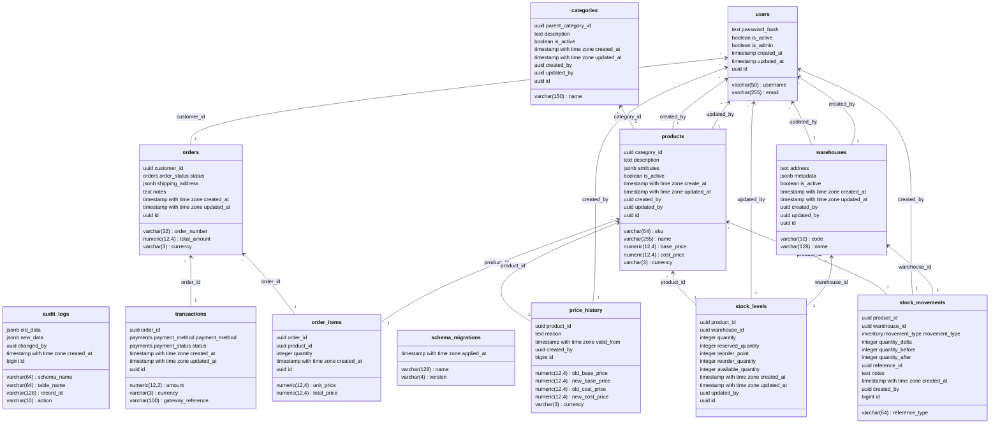

# ApexCore DB

A PostgreSQL-centric transactional schema for an e-commerce style OLTP system. Inventory, orders, payments, and auditing are modeled as separate schemas and implemented with tables, constraints, partial and composite indexes, generated columns, triggers, stored procedures, and reporting views. The business logic lives in the database, so it does not depend on any application layer.

The project was built to explore relational design and query behaviour under transactional workloads: index selection, locking, ledger-style data, and read models built on top of write tables.

---

## Highlights

- **Schema-per-domain design**: `core`, `inventory`, `orders`, `payments`, `audit`, `reporting`.
- **Index design**: partial indexes (for active warehouses and low-stock detection), composite indexes for common lookup paths, and indexes on foreign keys and status/date filters.
- **Generated columns**: `available_quantity = quantity - reserved_quantity` and `total_price = quantity * unit_price`, stored and always consistent.
- **Ledger tables**: append-only `stock_movements` and `payment transactions`, with `BIGINT GENERATED ALWAYS AS IDENTITY` keys.
- **Transactional procedures** that lock rows with `SELECT ... FOR UPDATE` before changing stock or order state.
- **Triggers**: audit logging (old/new values as `JSONB`) and price history capture.
- **Reporting views** for order financial summaries, stock availability, and warehouse valuation.
- **Migration-based workflow**: numbered forward migrations, matching rollback scripts, and SQL test scripts.

---

## Technology

| Area | Used |
|------|------|
| Database | PostgreSQL 16+ |
| Extensions | `pgcrypto` (UUID generation), `pg_stat_statements` (query statistics) |
| Procedural SQL | PL/pgSQL stored procedures and trigger functions |
| Data types | `UUID`, `NUMERIC(12,4)`, `JSONB`, `TIMESTAMPTZ`, `BIGINT` identity, `ENUM`, composite types (`orders.order_item_input`) |
| Constraints | `CHECK` (including regex format checks), `UNIQUE`, partial unique indexes, foreign keys |
| Indexing | B-tree, partial indexes, composite indexes, indexes on generated/derived predicates |
| Concurrency | Row-level locks (`FOR UPDATE`), transactional procedures |
| Auditing | Row-level triggers writing to `audit.audit_logs` |
| Reporting | Regular views over transactional tables |
| Tests | SQL scripts that create their own fixtures |

---

## Entity-relationship diagram

The diagram below shows the core tables and their foreign keys. Views are omitted. It is rendered by GitHub from Mermaid source stored in [`docs/erd.mmd`](docs/erd.mmd).



## Schema overview

### Schemas

| Schema | Contents |
|--------|----------|
| `core` | Users, `schema_migrations` |
| `inventory` | Categories, products, warehouses, stock levels, stock movements, price history |
| `orders` | Orders, order items, `order_item_input` type |
| `payments` | Payment transactions and refunds |
| `audit` | Audit log table and trigger function |
| `reporting` | Read-only views |

### Main tables

- `core.users`
- `inventory.categories`, `inventory.products`, `inventory.warehouses`
- `inventory.stock_levels`: quantity and reserved quantity per (warehouse, product), with a generated `available_quantity`
- `inventory.stock_movements`: append-only record of every stock change
- `inventory.price_history`: filled by a trigger on price change
- `orders.orders`, `orders.order_items` (with generated `total_price`)
- `payments.transactions`
- `audit.audit_logs`

### Indexes (selected)

| Index | Purpose |
|-------|---------|
| `idx_warehouses_active` (partial, `WHERE is_active`) | Fast lookup of active warehouses |
| `idx_stock_levels_low_stock` (partial, `WHERE available <= reorder_point`) | Low-stock scans without touching healthy rows |
| `idx_stock_levels_warehouse_id`, `idx_stock_levels_product_id` | Join and filter paths on stock |
| `idx_stock_movements_product_warehouse`, `idx_stock_movements_reference` | Movement history by product and by source document |
| `idx_price_history_product_valid` | Price lookup at a point in time |
| `ix_orders_customer_id`, `ix_orders_status`, `ix_orders_created_at` | Customer history, status queues, date range reports |
| `ix_order_items_order_id`, `ix_order_items_product_id` | Order detail and product sales lookups |
| `idx_payments_transactions_order_id`, `..._status` | Payments per order and status filters |
| `idx_audit_logs_table_record`, `idx_audit_logs_created_at` | Audit history by record and by time |
| `ux_categories_root_name`, `ux_categories_sibling_name` | Uniqueness among active categories (partial unique indexes) |

---

## Stored procedures

**Stock**
- `inventory.receive_stock`: add stock from a purchase receipt, locking the stock row and writing a movement
- `inventory.adjust_stock`: manual correction with a reason
- `inventory.record_stock_movement`: single entry point for writing movements
- `inventory.warehouse_transfer`: move stock between two warehouses

**Orders**
- `orders.place_order`: create an order from a list of `order_item_input` rows, read prices from `inventory.products`, and reserve stock
- `orders.cancel_order`: cancel an order and release reservations
- `orders.ship_order`, `orders.deliver_order`: status transitions
- `orders.return_order`: process returns and restore stock

**Payments**
- `payments.process_payment`: record a payment attempt and its result
- `payments.refund_payment`: record a refund against a payment

---

## Views

- `reporting.v_order_financial_summaries`: paid, refunded, and outstanding balance per order
- `reporting.v_stock_availability`: available quantity per product and warehouse
- `reporting.v_warehouse_valuation`: stock value per warehouse

The views read from the transactional tables, so reporting is expressed as SQL that can be inspected with `EXPLAIN` and tuned with indexes.

---

## Repository layout

```text
apexcore-db/
├── db/
│   ├── migrations/   # Numbered forward migrations (0001 to 0029)
│   ├── rollback/     # Down scripts for individual migrations
│   └── tests/        # SQL test scripts
├── .gitignore
└── README.md
```

---

## Getting started

Requirements: PostgreSQL 16 or newer and `psql`.

Create a database and apply the migrations in order:

```bash
createdb apexcore
for f in db/migrations/*.sql; do
  echo "Applying $f"
  psql -v ON_ERROR_STOP=1 -d apexcore -f "$f" || break
done
```

Run a test script:

```bash
psql -v ON_ERROR_STOP=1 -d apexcore -f db/tests/test_receive_stock.sql
```

---

## Usage examples

Receive stock:

```sql
CALL inventory.receive_stock(
    p_warehouse_id => '<warehouse-uuid>',
    p_product_id   => '<product-uuid>',
    p_quantity     => 100,
    p_reference_id => NULL,
    p_notes        => 'Initial stock'
);
```

Place an order with two items:

```sql
CALL orders.place_order(
    p_customer_id      => '<customer-uuid>',
    p_order_number     => 'ORD-0001',
    p_shipping_address => '{"city": "Tehran"}'::jsonb,
    p_items            => ARRAY[
        ROW('<product-uuid-1>', 2)::orders.order_item_input,
        ROW('<product-uuid-2>', 1)::orders.order_item_input
    ],
    p_notes            => NULL,
    p_order_id         => NULL
);
```

Query the reporting views:

```sql
SELECT * FROM reporting.v_stock_availability WHERE warehouse_id = '<warehouse-uuid>';
```

Inspect a query plan:

```sql
EXPLAIN (ANALYZE, BUFFERS)
SELECT * FROM orders.orders
WHERE customer_id = '<customer-uuid>'
ORDER BY created_at DESC
LIMIT 20;
```

Check the exact parameter lists in the migration files, since signatures changed across migrations.

---

## Design principles

- **Rules in the database.** Stock arithmetic, price sourcing, and audit capture happen in procedures, triggers, and constraints, so every client gets the same behaviour.
- **Derived values are generated.** `available_quantity` and `total_price` are stored generated columns, so they cannot drift from their inputs.
- **Movements explain balances.** `stock_levels` holds the current state; `stock_movements` records how it was reached.
- **Prices come from the server.** `place_order` reads `base_price` from `inventory.products` and does not accept a price from the client.
- **Read models are separate.** Reports use views over normalized tables; heavier analytics are meant to be fed from an outbox or CDC stream.

---

## Roadmap

- Migration runner and CI against a real PostgreSQL instance
- pgTAP-based tests and concurrency tests for stock reservation
- Benchmark notes with `EXPLAIN (ANALYZE, BUFFERS)` before and after each index
- Event outbox worker
- ERD and architecture decision records

---

## Contributing

Add a new numbered migration for each schema change rather than editing an existing one. Add a test for each procedure that changes stock or money.

## License

Not specified yet.
